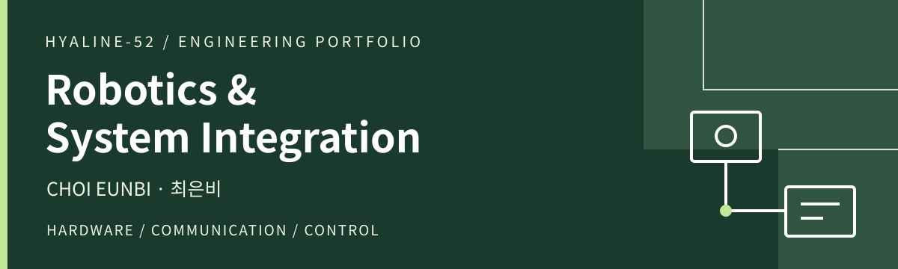
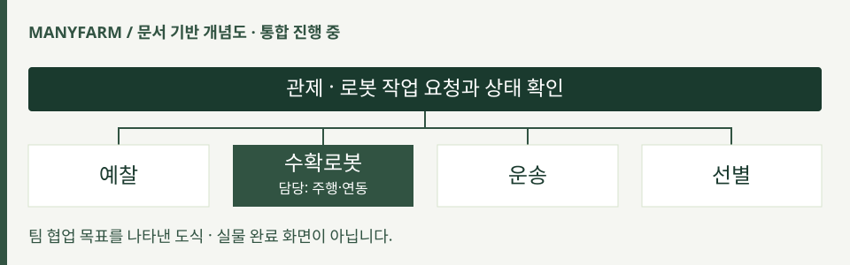

  <picture><source media="(max-width: 600px)" srcset="assets/profile-banner-mobile.svg"></picture>

### 로봇 하드웨어와 상위 소프트웨어를 연결합니다.
센서·제어기의 동작을 이해하고, **통신과 제어로 기능을 구현하며 실기기에서 통합을 확인합니다.**  
ROS 2 주행·관제 연동부터 STM32 센서 처리, Arduino 제어, PLC·HMI까지 경험했습니다.

## 01 / Selected Projects

### MANYFARM · 파프리카 다중 로봇 협업
`2026.09 ~ 진행 중` · `7인 팀` · **Featured project**

<a href="https://hyaline-52.github.io/manyfarm.html"><picture><source media="(max-width: 600px)" srcset="assets/manyfarm-flow-mobile.svg"></picture></a>

**담당 역할** · 수확로봇 주행·위치 보조, 관제·수확 측 인계 통신, 요구사항·FSM·인터페이스 설계 및 PM.

**핵심 구현** · Nav2 지도·제어 설정 → AprilTag 관측과 AMCL 보정 연결 → 관제 Action·Status 및 인계 인터페이스 연동.

> 당시 지도·설정의 주행과 모의 장치 인계 통신을 확인했습니다. **전체 실물 공정의 연속 통합은 진행 중**입니다.

[**시스템 구조와 담당 구현 →**](https://hyaline-52.github.io/manyfarm.html) · 팀 코드 비공개

<strong>검증 범위와 팀 역할</strong>

- 10월 10일 보정 적용 10건은 단일 주행의 이벤트 수입니다.
- 10월 11일 관제 연동 주행은 수확팔 동작을 제외한 시험입니다.
- 10월 13일 지정 경로 2회 연속 성공은 당시 지도·설정에 한정합니다.
- 10월 14일 인계 시험은 모의 장치·운송 이벤트 기반입니다.
- 최신 공통 통합본의 실물 배포·재시험은 미완료입니다.
- 비전·수확팔·관제 앱·시뮬레이션·운송 구현은 타 파트입니다.

---

### POCO · 자세 코칭에서 모니터암 제어로
`초기 2026.05 / 고도화 2026.08 ~ 2026.09` · `4인 팀`

고도화 팀 전체 결과물 · 보고서 4쪽. 초기 개발과 구분합니다.

- **초기 담당** · Arduino 펌웨어·Serial 명령 → LED·부저 알림, IMU 기반 카메라 수평 보정·서보 제어.
- **고도화 기여** · 기존 Motor1·2 자동추종 제어 연결·조건 처리, PyQt 설정 → Hardware Process → 부저 연동.

[**초기·고도화 구현 →**](https://hyaline-52.github.io/poco.html) · [초기 개인 코드](https://github.com/Hyaline-52/POCO-VisionPoseCoach) · [고도화 팀 코드](https://github.com/HONEYDEV0310/2026ESWContest_free_POCO)

<strong>서보 떨림 대응 · 팀 시험 결과와 검증 한계</strong>

초기 보정 완료 경로에 `detach`, 다음 보정 시작에 `attach`를 추가한 코드 변경을 확인했습니다.

실제 떨림 감소 효과와 반복 시험은 미검증이며, 제어 신호 유지가 측정으로 확정된 원인은 아닙니다.

고도화 팀 보고서의 POSE ONLY 실물 동적 시험은 22회, 20초 내 정착 22/22회, P95 1.442초, 거리 MAE 6.85mm입니다.

**개인 단독 시험 결과가 아니며** 실물 버전·세부 시험 조건은 추가 확인이 필요합니다. Face 비활성화는 당시 보고서 기준입니다.

AI·UI·모터 프레임워크는 팀 전체 구성입니다. Motor12 제어 전체나 IK 알고리즘을 단독 구현한 것이 아닙니다.

---

### KickCAN · STM32 센서 노드와 CAN 통신
`2026.07 개발 일정 기준` · `4인 팀`

팀 RC카 전체 결과물 · 공개 승인된 실물 사진.

**Node 1 담당** · 초음파·온도·조도 판단 → FreeRTOS Task → QueueCAN → CAN 송신. Main Node의 주행 상태를 수신해 초음파 송신 방향을 판단합니다.

> CLEAR 송신 코드 변경을 확인했습니다. **최종 Node 2 경고 해제·반복 시험은 미검증**입니다.

[**센서·메시지 처리 구조 →**](https://hyaline-52.github.io/kickcan.html) · [Node 1 코드](https://github.com/kick-can/Node_1)

<strong>통신 구조와 담당 경계</strong>

차량 노드는 공통 CAN 버스를 공유합니다. `0=전진`, `1=후진`, `2=정지` 상태를 수신하며, 초음파 방향 조건을 온도·조도에 적용하지 않습니다.

Main Node 차량 구동과 Node 2 경고·표시 출력은 타 파트입니다.

CAN 지연·센서 정확도는 확인된 성능 수치로 제시하지 않습니다.

---

### PLC · 자동화 공정 제어와 HMI
`2026.06 발표 / 개발 기간 미확정` · `2인 팀`

팀 HMI 화면 · 발표자료 12쪽. 화면 숫자는 실측 성능이 아닙니다.

**담당 역할** · 별도 운전 기능인 창고 비움, 작업 시간 측정 관련 래더, HMI 상태 표시와 운전 화면 구성.

> 발표자료와 역할 기록 기준입니다. **최종 PLC·HMI 원본 및 반복 실물 시험은 미검증**입니다.

[**공정 흐름과 구현 근거 →**](https://hyaline-52.github.io/plc.html)

<strong>공정과 팀 역할 구분</strong>

자동 공정은 원점 복귀 → 소재 투입·이송 → 재질 판별 → 적재입니다. 창고 비움은 HMI 요청에 따른 별도 운전으로, 자동 시퀀스 중 실행이 제한됩니다.

기본 시퀀스·Teaching·비상정지는 타 파트이며, 팀 HMI 전체를 단독 작성한 것으로 표현하지 않습니다. 스토퍼 간섭 조치의 개인 수행 범위와 수정 후 결과는 확인 필요입니다.

## 02 / Tech & Experience

### Languages

   
센서 펌웨어와 하드웨어 프로세스의 처리 로직 구현

### Robotics

     
주행 설정 · 위치 보조 · 관제 Action·Status 연동

### Embedded & Control

     
센서 판단 · Task·Queue · LED·부저·서보 · 설비 운전 기능

### Communication

    
장치 명령·상태 전달과 로봇 작업 인계 인터페이스

### Application & Tools

    
UI 설정을 하드웨어 동작으로 연결 · 래더와 운전 화면 구성

## 03 / Background

**학력**
- **한양사이버대학교** · 경영정보학과 / AI비즈니스전공 · 2023.02
- **한경국립대학교** · 전기전자제어공학과 · 2019.02
- **오산대학교** · 전자과 · 2016.02

**교육**
- **서울기술교육센터** · AI 융합 로봇 SW 개발자 · 2026.04 ~ 2026.11 수료 예정
- **휴먼교육센터 수원** · 디지털컨버젼스기반 JAVA 개발자 양성과정 · 2020.02 ~ 2020.08 수료

**자격 · 성과**
- 정보처리기사
- 2014 스마트 로봇 경진대회 부문기술상
- 2026 임베디드 소프트웨어 경진대회 **결선 진출**

---

**장치 연동·통신·제어 기능 구현과 실기기 통합 시험에 관심이 있습니다.**  
[웹 포트폴리오](https://hyaline-52.github.io/) · [A4 / PDF 저장](https://hyaline-52.github.io/print.html) · [eunbi52robot@gmail.com](mailto:eunbi52robot@gmail.com)
