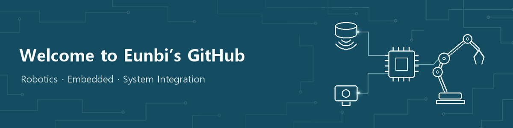

  

  
  
  

## 👋 About Me

로봇·임베디드·산업 자동화 프로젝트에서 장치 제어와 소프트웨어 연동을 개발하고 있습니다.

- 💻 **Focus**: 장치 제어·통신 기능 구현과 시스템 통합
- 🧩 **Identity**: 센서 입력과 장치 상태를 이해하고, 소프트웨어의 명령을 실제 동작으로 연결하는 개발자
- 🔧 **Interests**: 로봇 주행·위치 보정, 상태 기반 제어 로직, 하드웨어·소프트웨어 연동

---

## 🛠️ Tech Stack & Tools

### Languages

  

### Robotics & Navigation

      

### Embedded & Hardware

    

### Communication

   

### Application & Automation

   

### Development Environment

  

### Collaboration Tools

   

---

## 🚀 Featured Projects

### 🤖 [ManyFarm | 다중 로봇 협업 스마트팜](https://github.com/Hyaline-52/MANYFARM-Robot-Integration)

> 예찰·수확·운송·선별을 관제로 연결하는 다중 로봇 협업 시스템

- **Period**: 2026.09–11
- **Team**: 7명
- **Role**: 수확로봇 주행·위치 보정·관제 및 Jetson 연동·인계·복귀 통합 / PM

**Stack**

    

**Highlights**
- Nav2 주행 설정과 차체 충돌 조건 조정, AprilTag 관측 시각 보정 및 AMCL 연동
- 관제·Jetson 요청과 인계·복귀 동작 통합, 초기 공통 구조·예찰 설계 공동 참여

[📂 Repository](https://github.com/Hyaline-52/MANYFARM-Robot-Integration) · [🤖 프로젝트 상세](https://hyaline-52.github.io/manyfarm.html)

---

### 🖥️ [POCO | AI 자세 코칭 모니터암](https://github.com/Hyaline-52/POCO-VisionPoseCoach)

> 사용자 자세를 분석해 피드백하고, 정상 자세에서 모니터 위치와 수평을 조절하는 시스템

- **Period**: 초기 2026.05 / 고도화 2026.08–09
- **Team**: 4명
- **Role**: 초기 Arduino 펌웨어·Serial·알림·카메라 보정 / 고도화 Motor1·2 제어 연결·조건 처리·하드웨어 통합

**Stack**

    

**Highlights**
- Serial 명령을 LED·부저와 카메라 서보 동작으로 연결하고 보정 완료·재시작 조건 처리
- 공동 개발한 Motor1·2의 제어 연결과 실행 조건 처리, PyQt 설정·새 Pose 프레임의 알림 연동

🏅 **임베디드 소프트웨어 경진대회 결선 진출** · 팀 프로젝트 성과

[📂 Repository](https://github.com/Hyaline-52/POCO-VisionPoseCoach) · [🤖 프로젝트 상세](https://hyaline-52.github.io/poco.html)

---

### 🔌 [KICK-CAN | STM32 분산 임베디드 RC카](https://github.com/Hyaline-52/KickCAN-Node1)

> 무선 Controller와 CAN 차량 네트워크를 연결해 주행·센서 감지·상태 표시를 구현한 시스템

- **Period**: 2026.07
- **Team**: 4명
- **Role**: Node 1 센서 판단·FreeRTOS Task·Queue 구성·CAN 송수신

**Stack**

    

**Highlights**
- 초음파·온도·조도 입력을 상태로 변환하고 센서 Task와 CAN 송신 Task를 Queue로 연결
- Main Node 주행 상태 수신, 방향별 초음파 처리 및 Echo 완료·CLEAR 전달 경로 수정

[📂 Repository](https://github.com/Hyaline-52/KickCAN-Node1) · [🤖 프로젝트 상세](https://hyaline-52.github.io/kickcan.html)

---

### ⚙️ [PLC | 자동화 공정 제어 및 HMI](https://github.com/Hyaline-52/PLC-Automated-Warehouse)

> 소재 공급·이송·재질 판별·적재를 자동화하고, HMI에서 별도 운전과 상태를 관리하는 공정

- **Period**: 2026.06
- **Team**: 2명
- **Role**: 창고 비움·TTMR 작업 시간 측정·HMI 구성·코드 통합

**Stack**

  

**Highlights**
- 자동 적재와 구분되는 창고 비움 기능, 작업 시간 측정과 HMI 운전·상태 표시 구성
- 코드 통합 후 시퀀스 간 실행 조건 정리와 창고 비움의 스토퍼 동작 순서 수정

[📂 Repository](https://github.com/Hyaline-52/PLC-Automated-Warehouse) · [🤖 프로젝트 상세](https://hyaline-52.github.io/plc.html)

---

## 📚 Background

### 교육

- **대한상공회의소 서울기술교육센터** · AI 융합 로봇 SW 개발자 과정 · 2026.04–11 수료
- **휴먼교육센터 수원** · 디지털컨버전스 기반 JAVA 개발자 양성과정 · 2020.02–08 수료

### 학력

- **한양사이버대학교** · 경영정보학과 AI비즈니스전공
- **한경국립대학교** · 전기전자제어공학과
- **오산대학교** · 전자과

### 자격 · 수상 · 주요 성과

- 정보처리기사
- 2014 스마트 로봇 경진대회 부문기술상
- 2026 임베디드 소프트웨어 경진대회 **결선 진출**

---

[Portfolio](https://hyaline-52.github.io/) · [PDF 저장](https://hyaline-52.github.io/print.html) · [Email](mailto:eunbi52robot@gmail.com)
